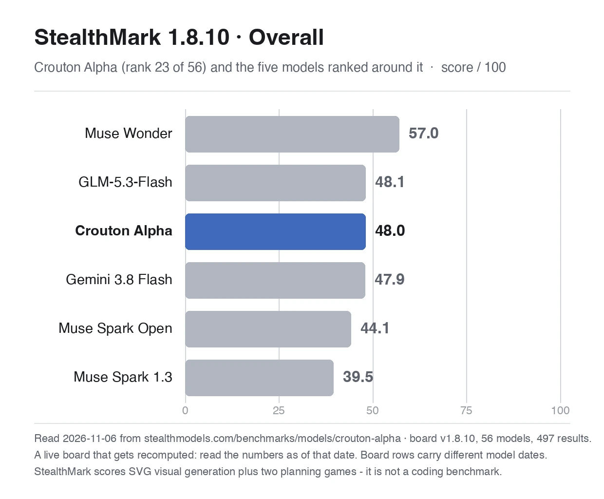
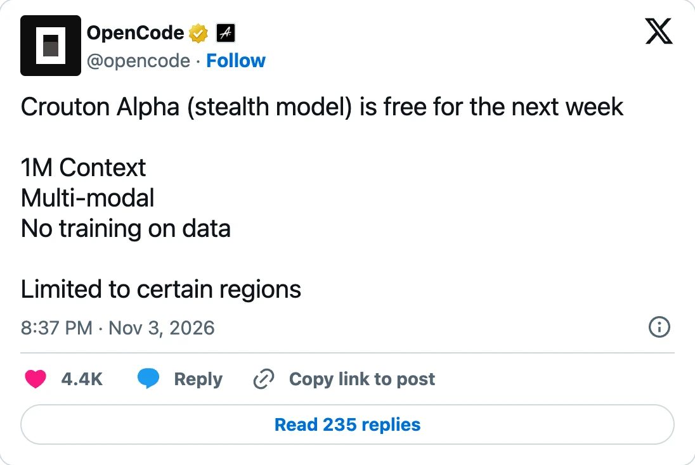
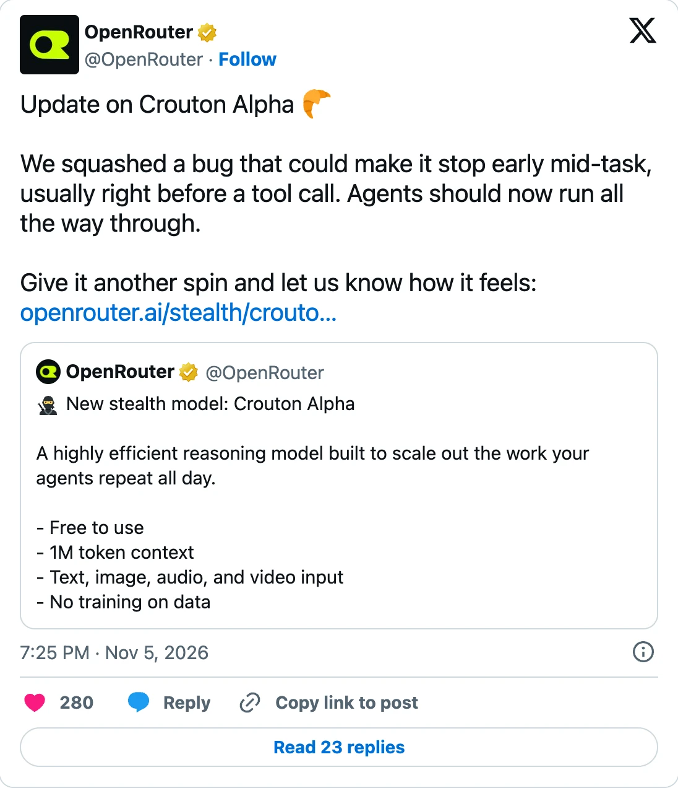

> **Short answer.** Yes, Crouton Alpha is free right now on five channels: [OpenRouter](https://freetokens.fyi/channels/openrouter), [Kilo Code](https://freetokens.fyi/channels/kilo-code), [OpenCode Zen](https://freetokens.fyi/channels/opencode-zen), [OpenCode Go](https://freetokens.fyi/channels/opencode-go) and [Command Code](https://freetokens.fyi/channels/command-code). Each has its own sign-up rules, and two of them need a paid plan. No channel has published an end date. The only hint is OpenCode's post on 3 November calling it free "for the next week".[^opencode-launch]
>
> Nobody has said who made it. Several clues point toward Meta, and token-count tests point away from the Muse models Meta has published.

{{live:where-to-use model=crouton-alpha}}

[Crouton Alpha](https://freetokens.fyi/models/crouton-alpha) appeared on 3 November as an anonymous "stealth" model with a 1M-token context window, free on launch day.[^openrouter-launch] By 6 November it was on five free channels. It's fast and decent at short coding tasks, people disagree about everything else, and its maker hasn't come forward.

The first half of this page gives the answers. The [deep dive](#deep-dive) has the channel record, the tests under their real conditions, and the identity evidence one item at a time.

## Where to use it free {#where-free}

| Channel | Free since | What you need |
|---|---|---|
| [OpenRouter](https://freetokens.fyi/channels/openrouter) | 3 Nov | An OpenRouter account. The free plan allows 50 requests a day, or 1,000 after you buy $10 of credits.[^openrouter-pricing] |
| [Kilo Code](https://freetokens.fyi/channels/kilo-code) | 4 Nov | Kilo Code. The gateway lists it at $0 with no expiry date.[^kilo-list] |
| [OpenCode Zen](https://freetokens.fyi/channels/opencode-zen) | 3 Nov | The OpenCode app or CLI, signed in to an OpenCode Console account.[^opencode-free] |
| [OpenCode Go](https://freetokens.fyi/channels/opencode-go) | 6 Nov | A Go subscription. Go lists it as "Unlimited" on every tier.[^go-docs] |
| [Command Code](https://freetokens.fyi/channels/command-code) | 6 Nov | A Go plan or above and at least $1 of credit. Up to 1,000 requests a day.[^command-terms] |

The dates are when each channel announced it, or, for Kilo, Go and Command Code, when our daily catalogue check first found it.[^model-page] Pick `stealth/crouton-alpha` on OpenRouter and Kilo, or `crouton-alpha-free` on OpenCode.[^zen-list]

Nous Portal also lists it at $0 in its model directory, but we don't track Nous as a channel.[^nous-list]

It isn't available everywhere. OpenRouter says it is "not currently available through EU in-region routing", and OpenCode lists it for certain regions only.[^openrouter-page][^opencode-launch]

## Until when {#until-when}

No channel has published a date in the pages we checked. OpenCode's launch post said "free for the next week" on 3 November.[^opencode-launch] Read literally, that's around 10 November, but nobody has confirmed that date. The other channels use open wording: "for a limited time" on OpenCode's docs, an empty expiry field at Kilo, and Command Code's "while the stealth preview lasts".[^opencode-docs][^kilo-list][^command-terms]

No channel has said what it will cost afterwards. AI/ML API notes that two earlier stealth models, Ox Alpha and Space Bunny Alpha, later got public names, and says those timelines don't predict when Crouton will get one.[^aimlapi]

## How good it is {#how-good}

**Fast, and fine on short coding jobs.** Two outside testers ran small coding sets and it passed them all: 30 of 30 coding tasks in a Cold Iron run, and six of six short tasks at AI/ML API, with both tool-call tests passed.[^cold-iron][^aimlapi] Both testers warn that one run is a hint, not a ranking.

**Mid-pack on a broader board.** On StealthMark, which tests visual and planning tasks rather than code, it scores 48.0 and ranks 23rd of 56.[^stealthmark] That puts it level with GLM-5.3-Flash and Gemini 3.8 Flash, above both public Muse Spark listings, and well below Muse Wonder.

**Our calls worked, slowly at times.** On 6 November we called it twice on Zen and twice on Go, an hour apart. Every call succeeded, and each time it wrote a small program, ran it through a tool call and passed its tests. Speed swung a lot: the first round streamed at roughly 27 to 43 tokens a second, and in the second round the first output took 43 to 48 seconds to arrive.

**Users are split.** Of the posts we coded, four are negative, four mixed and two positive. The most common complaints are hallucination and stopping in the middle of a task, and the most common praise is speed. The [Community take](https://freetokens.fyi/models/crouton-alpha#community-sec) on the model page shows every post and how we counted it.[^model-page]

On 5 November OpenRouter said it had fixed a bug that could make the model stop early, "usually right before a tool call".[^bugfix] Reports from before that date describe a problem that may no longer exist.

## Who made it {#maker}

Nobody has said. OpenRouter's page calls it a stealth model run by a third-party provider that chose to stay anonymous.[^openrouter-page] Asked directly, it told us: "I cannot verify my maker here; my presentation name is Crouton Alpha."

The clues mostly point at [Meta](https://freetokens.fyi/makers/meta), but none of them is proof:

- **Pointing toward Meta.** One tracker found it blocked in the same 21 countries as Meta's model API, tripping on a rare Japanese word that every Muse model trips on, and offering reasoning-effort settings that only Meta's Muse listings share.[^aitracker-clues][^pokebench] One post claims its traffic resolves to a Meta network, without showing how.[^chetaslua]
- **Pointing away from the published Muse models.** Its token counts don't match Meta's published tokenizer.[^aitracker-tokens] AI/ML API compared 23 test strings against seven models, including Muse Wonder and Muse Spark 1.3, and none matched more than four counts.[^aimlapi]

Put together, Crouton Alpha looks like it runs on Meta's platform, and may be a Muse model that hasn't been released, but neither Meta nor any channel has said so. Fingerprints like these can point at a family. They can't name a model. The [deep dive](#identity) goes through each clue.

## What to watch {#watching}

- **The end date.** If OpenCode's "next week" holds, the free period ends around 10 November. The live card above changes as soon as a channel drops it.
- **A name.** A statement from a lab or a channel would settle the Meta question. Until then, treat every maker claim as a guess.
- **Reliability after the fix.** Most reports of stalled runs come from before 5 November. Newer reports will show whether the fix holds up on long agent runs.

---

## Deep dive {#deep-dive}

### The channel record {#channels}

**[OpenRouter](https://freetokens.fyi/channels/openrouter)** announced it on 3 November as a free stealth model with a 1M context window and text, image, audio and video input.[^openrouter-launch] The model page lists the provider as "Stealth" at $0 for input and output, and says the anonymous provider runs the model while OpenRouter only routes requests.[^openrouter-page]

**[OpenCode Zen](https://freetokens.fyi/channels/opencode-zen).** OpenCode posted the same day: free "for the next week", multimodal, limited to certain regions.[^opencode-launch] The Zen catalogue lists `crouton-alpha-free` at $0 in and out, with a 1M context window and up to 270,000 output tokens.[^zen-list] OpenCode's docs define a free model as one with no input price, and when you're signed out the provider doesn't appear until you connect an OpenCode Console account.[^opencode-free]

**[Kilo Code](https://freetokens.fyi/channels/kilo-code).** Our daily check first found `stealth/crouton-alpha` in Kilo's gateway catalogue on 4 November, at zero cost with no expiry date.[^model-page][^kilo-list]

**[OpenCode Go](https://freetokens.fyi/channels/opencode-go).** Our check first found it in the Go catalogue on 6 November, with the same limits as Zen.[^model-page][^go-list] Go is a paid plan. Its docs list Crouton as "Unlimited" on every tier and say you can keep using free models after you reach the plan's usage limit.[^go-docs]

**[Command Code](https://freetokens.fyi/channels/command-code)** lists it as a free preview "while the stealth preview lasts", for customers on a Go plan or above with at least $1 of credit, up to 1,000 requests a day.[^command-terms] Like Go, it's a zero price inside a paid account.

### The tests, under their real conditions {#benchmarks}

**Cold Iron** (posted 3 November). It passed 140 of 157 tasks with reasoning effort set to `minimal`: coding 30 of 30, instructions 29 of 30, reasoning 29 of 30, prose 28 of 30, math 19 of 30, writing 3 of 5, and both tool-calling tasks.[^cold-iron] Math is the weak spot. The provider requires reasoning, so `minimal` still used reasoning tokens on 26 tasks. The run placed it 10th of 26 models on that board, and the author calls a single run a hint.

**AI/ML API** (run 4 November). Six short coding tasks and two tool tasks, all passed, with a median of 3.8 seconds per coding task at the default effort.[^aimlapi] At the lowest effort the median dropped to 2.1 seconds, and a short story streamed at 114 to 129 tokens a second. AI/ML API resells model access, so this is a vendor testing a model it sells, and it says its tasks were short.

**StealthMark** (first run 4 November). Nine results, overall 48.0, rank 23 of 56, general intelligence 43.5, visual 56.0.[^stealthmark] Its individual tasks range from 32.3 on a planning task to 60.7 on an image task. The board measures image generation and planning games. It says nothing about coding, so read the 48.0 as a general-purpose signal, not a verdict on whether it can work in your repo.

**Our calls** (6 November, two rounds an hour apart, on Zen and on Go). Each round asked who made it, asked for a short story, and ran a coding task: write a small function with tests, run it through a tool call, then rerun the result ourselves. All four coding runs passed. In the first round the story streamed at about 27 tokens a second on Zen and 43 on Go. In the second round the first output took 43 seconds on Zen and 48 on Go. Four calls show that the basic tool loop works. They don't show how it handles a large codebase.

### What people said {#community}

Our [Community take](https://freetokens.fyi/models/crouton-alpha#community-sec) counts 18 posts from 15 independent authors, collected on 4 November. The posts compare it most often with Muse Spark 1.3, usually as similar.[^model-page] A few voices from both sides:

- "the level of hallucination, i have never seen with any Chinese flash models" (u/No-Efficiency402, r/opencodeCLI, 4 Nov).[^reddit-hallucination]
- "The speed is incredible", but "the quality is nowhere near what I expected" (@SPAC89 on X, 3 Nov, testing in T3 Code at the highest reasoning setting).[^spac89]
- "Looks like a good model for agent work that repeats a lot of searches" (@latent_node on X, 4 Nov, after two 15 of 15 runs).[^latent-node]
- "Pretty weak at Three.js in my tests" (@superalesha on X, 4 Nov).[^superalesha]

The most concrete complaint has a paper trail. A GitHub issue opened on 3 November describes agents stopping after a short answer or a few tool calls.[^issue-stall] OpenRouter's fix followed on 5 November.[^bugfix] Nobody has yet shown whether it fixed every case.

### The identity evidence, one item at a time {#identity}

**Blocked countries.** On 3 November, AI Tracker Bot reported that Crouton Alpha is blocked in the same 21 countries as Meta's model API.[^aitracker-clues]

**The rare Japanese word.** The same post says it trips on a rare Japanese word that every Meta Muse model trips on, while 93 other models didn't miss it.[^aitracker-clues]

**Reasoning-effort settings.** It offers six effort levels, from `minimal` to `max`. Of 454 models on OpenRouter, only Meta's Muse listings share them.[^aitracker-clues][^pokebench] AI Tracker Bot ended its post with two words: "Not confirmed."

, ending with “Not confirmed.” Source: https://x.com/aitrackerbot/status/2117715857237258558 Shot: 2026-11-06")

**The network claim.** On 4 November a widely shared post said the route resolves to a Facebook network, the same one Muse Spark 1.3 uses.[^chetaslua] The post doesn't show the trace, so nobody else can check it.

**Token counts.** Here the evidence turns. AI Tracker Bot itself noted that its token counts don't match Meta's published tokenizer, "so it may use a new one".[^aitracker-tokens] AI/ML API compared counts on 23 strings with seven models, Muse Wonder and Muse Spark 1.3 among them, and none matched more than four. It adds that request formatting and provider accounting can shift counts.[^aimlapi] Another tester checked 20 models with nine local tokenizers and found "No exact match."[^superalesha]

**Style.** Some users say it feels like Muse Spark.[^yama] That is a reader's impression, not a fingerprint.

The serving-side clues line up with Meta. The token counts don't line up with any Muse model Meta has published. If it is Meta's, it is probably a model Meta hasn't released yet. [Space Bunny Alpha](https://freetokens.fyi/blog/space-bunny-alpha) had the same kind of evidence, and it stopped at the family too.

### What happens to your prompts {#data-policy}

The channels don't agree, so check the one you use:

| Channel | What it says |
|---|---|
| OpenCode Zen and Go | Data is "retained for 30 days and is not used for model training".[^opencode-docs][^go-docs] |
| OpenRouter | Prompts "may be retained by the provider but are not used for training". The page's machine-readable fields disagree with each other on training.[^openrouter-page] |
| Kilo Code | The gateway flag `mayTrainOnYourPrompts` is set to true.[^kilo-list] |
| Command Code | The provider "may keep your prompts and outputs", with no mention of training.[^command-terms] |

None of them explains the difference. If your prompts are sensitive, OpenCode's wording is the clearest.
