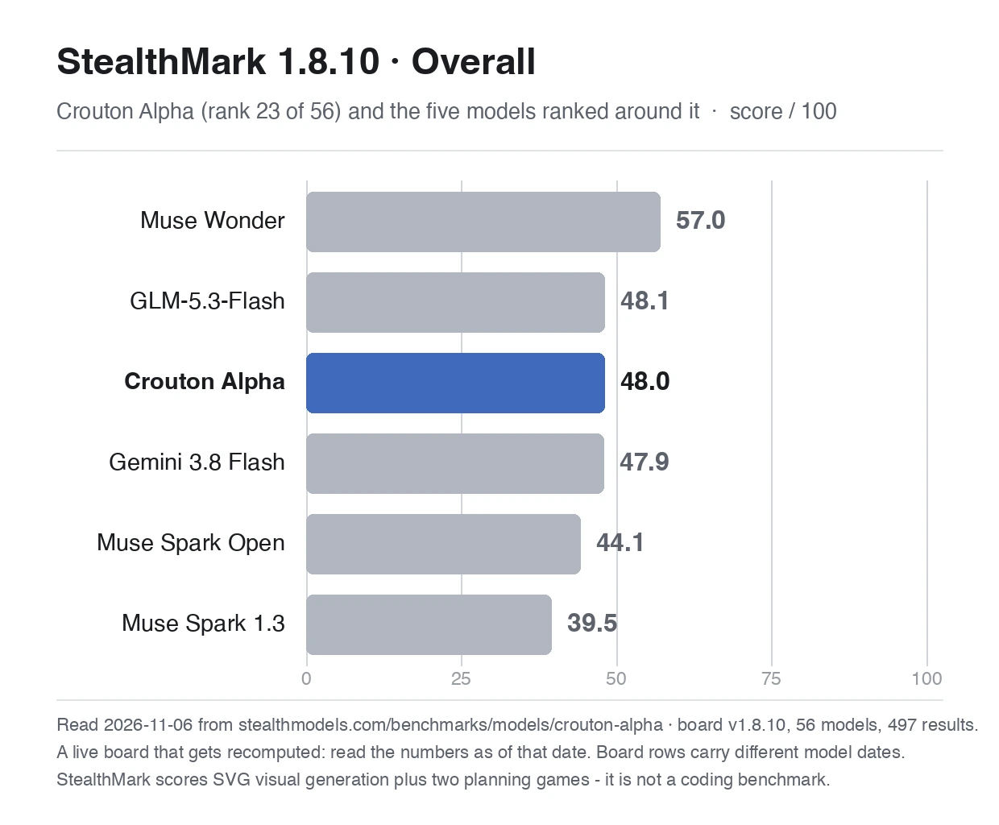
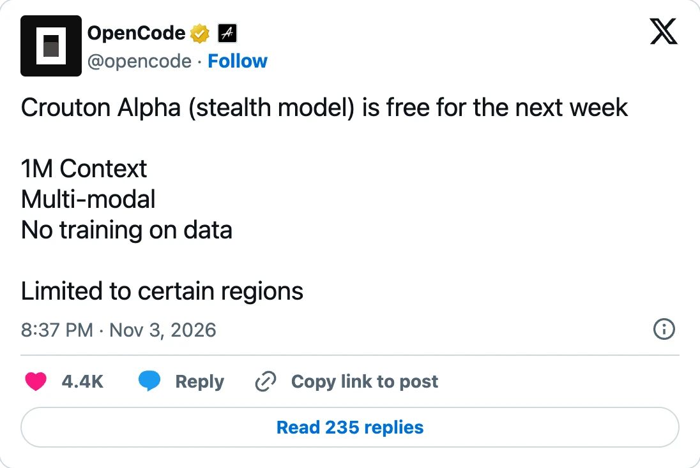
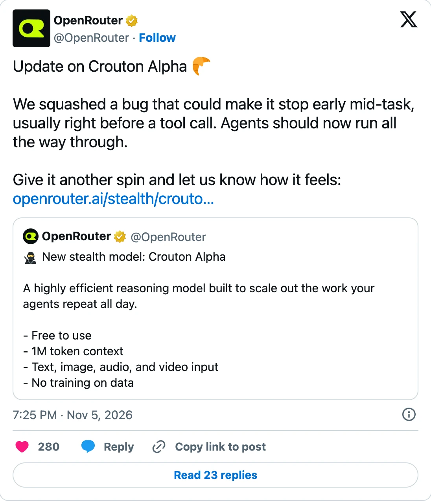
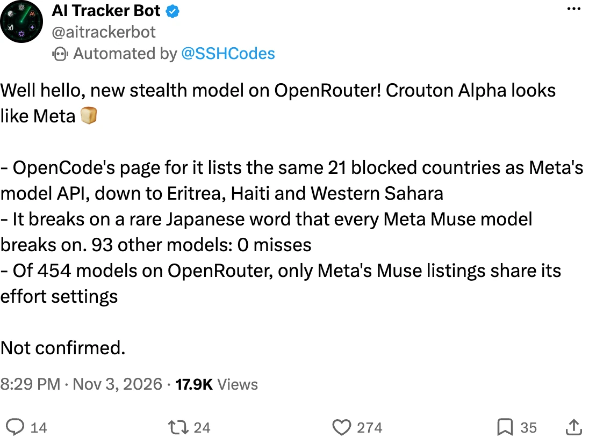

> **先说结论。** Crouton Alpha 目前在 [OpenRouter](https://freetokens.fyi/zh/channels/openrouter)、[Kilo Code](https://freetokens.fyi/zh/channels/kilo-code)、[OpenCode Zen](https://freetokens.fyi/zh/channels/opencode-zen) 、[OpenCode Go](https://freetokens.fyi/zh/channels/opencode-go) 和 [Command Code](https://freetokens.fyi/zh/channels/command-code) 五个渠道免费。各家的注册和使用条件不同，其中两家需要付费套餐，暂时都没有公布结束日期。OpenCode 只在 11 月 3 日的帖子里说“free for the next week”（接下来一周免费）。[^opencode-launch]
>
> 目前没有公司承认做了这个模型。几条线索指向 Meta，但 token 数量测试又显示，它和 Meta 已公开的 Muse 模型对不上。

{{live:where-to-use model=crouton-alpha}}

[Crouton Alpha](https://freetokens.fyi/zh/models/crouton-alpha) 于 11 月 3 日以匿名“stealth”模型的身份出现，首发时免费，上下文窗口为 1M token。[^openrouter-launch] 到 11 月 6 日，它已出现在五个免费渠道。它响应快，短编码任务表现尚可；其他方面的评价分歧较大，制造方仍未露面。

上半部分先回答能不能用、表现如何、谁可能做的。想核对渠道记录、测试条件和身份线索，可以看[详细资料](#deep-dive)。

## 哪些渠道可以免费用 {#where-free}

| 渠道 | 开始免费 | 使用条件 |
|---|---|---|
| [OpenRouter](https://freetokens.fyi/zh/channels/openrouter) | 11 月 3 日 | 需要 OpenRouter 账号。免费计划每天可发 50 次请求；购买 10 美元额度后，每天上限为 1,000 次。[^openrouter-pricing] |
| [Kilo Code](https://freetokens.fyi/zh/channels/kilo-code) | 11 月 4 日 | 需要使用 Kilo Code。网关目录标价为 0 美元，未填写到期日期。[^kilo-list] |
| [OpenCode Zen](https://freetokens.fyi/zh/channels/opencode-zen) | 11 月 3 日 | 需要使用 OpenCode 应用或命令行，并登录 OpenCode Console 账号。[^opencode-free] |
| [OpenCode Go](https://freetokens.fyi/zh/channels/opencode-go) | 11 月 6 日 | 需要 Go 订阅。Go 的所有套餐都把它标为“Unlimited”（不限量）。[^go-docs] |
| [Command Code](https://freetokens.fyi/zh/channels/command-code) | 11 月 6 日 | 需要 Go 套餐或更高等级，账户至少有 1 美元额度；每天最多 1,000 次请求。[^command-terms] |

表里的日期是渠道公告时间；Kilo、Go 和 Command Code 则是我们每天检查目录时首次发现它的日期。[^model-page] 在 OpenRouter 和 Kilo 上选择 `stealth/crouton-alpha`，在 OpenCode 上选择 `crouton-alpha-free`。[^zen-list]

Nous Portal 的模型目录也把它列为 0 美元，但我们没有把 Nous 当作渠道跟踪。[^nous-list]

并非所有地区都能用。OpenRouter 说明它“not currently available through EU in-region routing”（目前不能通过欧盟区域内路由使用）；OpenCode 则只在部分地区开放。[^openrouter-page][^opencode-launch]

## 免费到什么时候 {#until-when}

我们查到的页面都没有公布具体结束日期。OpenCode 11 月 3 日的发布帖说“free for the next week”（接下来一周免费）。照字面理解，大约到 11 月 10 日，但没有人确认这一天。其他渠道的说法也没有给出日期：OpenCode 文档称“限时”，Kilo 的到期栏为空，Command Code 则说“while the stealth preview lasts”（隐身预览期间）。[^opencode-docs][^kilo-list][^command-terms]

各渠道也没说之后会不会收费，或会收多少。AI/ML API 提到，之前的隐身模型 Ox Alpha 和 Space Bunny Alpha 后来都公开了名字，但它也说，这些先例推不出 Crouton 什么时候会公开。[^aimlapi]

## 表现怎么样 {#how-good}

**速度快，短编码任务表现尚可。** 两个外部测试者用小型编码题集测试，都通过了全部编码题：Cold Iron 的一轮测试为 30 题全过，AI/ML API 的短任务为 6 题全过，两个工具调用测试也都通过。[^cold-iron][^aimlapi] 两位测试者都提醒，单次测试只能提供线索，不能当成排名结论。

**综合榜单处于中游。** StealthMark 测的是视觉和规划任务，不是编程。Crouton Alpha 得分 48.0，在 56 个模型中排第 23。[^stealthmark] 它与 GLM-5.3-Flash、Gemini 3.8 Flash 接近，高于榜单上的两个公开版 Muse Spark，低于 Muse Wonder。

**我们调用成功过，等待时间有时很长。** 11 月 6 日，我们在 Zen 和 Go 上各调用两次，两轮间隔一小时。四次请求都成功；每次都生成了一个小程序，通过工具调用运行，并通过测试。速度波动明显：第一轮输出速度约每秒 27 至 43 个 token，第二轮则等了 43 至 48 秒才收到首段输出。

**用户评价不一。** 我们归类的帖子里，负面评价 4 条、褒贬都有 4 条、正面评价 2 条。最常见的抱怨是幻觉和任务中途停止；最常见的好评是速度快。模型页的[社区评价](https://freetokens.fyi/zh/models/crouton-alpha#community-sec)列出了所有帖子和分类方式。[^model-page]

11 月 5 日，OpenRouter 表示修复了一项会让模型提前停止的错误，通常发生在工具调用前。[^bugfix] 这一天之前的反馈，描述的问题可能已经不存在。

## 谁做的 {#maker}

没有人公开认领。OpenRouter 页面称它由选择匿名的第三方提供方运行。[^openrouter-page] 我们直接询问模型制造方时，它回答：“I cannot verify my maker here; my presentation name is Crouton Alpha.”（我无法在这里确认制造方；我显示的名称是 Crouton Alpha。）

线索大多指向 [Meta](https://freetokens.fyi/zh/makers/meta)，但都不能证明身份：

- **有些线索指向 Meta。** 一位追踪者发现，它和 Meta 模型 API 在相同的 21 个国家或地区受限；它会被一个罕见日语词难住，而所有 Muse 模型也会被这个词难住；它还提供了只有 Meta 的 Muse 模型列表才有的推理强度选项。[^aitracker-clues][^pokebench] 另有帖子声称流量会解析到 Meta 网络，但没有展示核验过程。[^chetaslua]
- **它又不像 Meta 已公开的 Muse 模型。** 它的 token 计数和 Meta 公布的分词器不一致。[^aitracker-tokens] AI/ML API 用 23 段测试文本对比了七个模型，其中包括 Muse Wonder 和 Muse Spark 1.3；没有一个模型的计数能匹配超过四段。[^aimlapi]

LINUX DO 上也有人猜它是 Muse 系列的 Flash 模型；该站需要登录，本文只看到[摘要](https://linux.do/t/topic/3118092/3)，这仍是社区猜测。

综合来看，Crouton Alpha 可能运行在 Meta 的平台上，也可能是尚未发布的 Muse 模型，但 Meta 和各渠道都没有确认。指纹线索可以指向一个模型家族，无法单凭这些线索认定具体型号。[详细资料](#identity)逐项列出证据。

## 接下来关注什么 {#watching}

- **结束日期。** 如果 OpenCode 所说的“接下来一周”成立，免费期大约在 11 月 10 日结束。上方实时卡片会在渠道下架后更新。
- **官方认领。** 实验室或渠道的声明，才能回答 Meta 是否参与。在此之前，制造方说法都应视为猜测。
- **修复后的稳定性。** 多数中途停止的报告早于 11 月 5 日。后续反馈能说明这项修复是否也适用于长时间运行的智能体任务。

---

## 详细资料 {#deep-dive}

### 渠道记录 {#channels}

**[OpenRouter](https://freetokens.fyi/zh/channels/openrouter)** 于 11 月 3 日宣布推出这款免费隐身模型，上下文窗口为 1M，可输入文字、图片、音频和视频。[^openrouter-launch] 模型页将提供方列为“Stealth”，输入和输出价格均为 0 美元，并说明模型由匿名提供方运行，OpenRouter 只负责转发请求。[^openrouter-page]

**[OpenCode Zen](https://freetokens.fyi/zh/channels/opencode-zen)。** OpenCode 同日发帖，称模型多模态、只在部分地区开放，并会“free for the next week”（接下来一周免费）。[^opencode-launch] Zen 目录把 `crouton-alpha-free` 的输入和输出价格都列为 0 美元，上下文窗口为 1M，最多可输出 270,000 个 token。[^zen-list] OpenCode 文档把免费模型定义为输入价格为零的模型；退出登录后，连接 OpenCode Console 账号之前看不到提供方。[^opencode-free]

**[Kilo Code](https://freetokens.fyi/zh/channels/kilo-code)。** 我们每日检查时，首次在 11 月 4 日的 Kilo 网关目录中发现 `stealth/crouton-alpha`，价格为 0 美元，且没有到期日期。[^model-page][^kilo-list]

**[OpenCode Go](https://freetokens.fyi/zh/channels/opencode-go)。** 我们在 11 月 6 日首次于 Go 目录中发现它，限制与 Zen 相同。[^model-page][^go-list] Go 是付费套餐。文档将 Crouton 标为所有套餐“不限量”，并说明套餐达到使用上限后仍可继续使用免费模型。[^go-docs]

**[Command Code](https://freetokens.fyi/zh/channels/command-code)** 把它列为免费预览，称免费期会持续到隐身预览结束。用户需订阅 Go 或更高等级，账户至少有 1 美元额度，每天最多可请求 1,000 次。[^command-terms] 和 Go 一样，这是付费账户里的零价模型。

### 测试结果与测试条件 {#benchmarks}

**Cold Iron**（11 月 3 日发布）。推理强度设为 `minimal` 时，157 项任务通过 140 项：编码 30/30、指令 29/30、推理 29/30、散文 28/30、数学 19/30、写作 3/5，两个工具调用任务都通过。[^cold-iron] 数学是较弱的一项。提供方要求启用推理，因此即使设为 `minimal`，仍有 26 项任务使用了推理 token。这轮测试在该榜单的 26 个模型中排第 10；作者也提醒，单次测试只能作为线索。

**AI/ML API**（11 月 4 日测试）。六项短编码任务和两项工具任务全部通过；默认强度下，每项编码任务的中位用时为 3.8 秒。[^aimlapi] 调至最低强度后，中位数降至 2.1 秒。一段短篇故事的输出速度为每秒 114 至 129 个 token。AI/ML API 转售模型调用服务，因此这是供应商测试自己销售的模型；它也说明测试任务较短。

**StealthMark**（11 月 4 日首次测试）。九项结果的总分为 48.0，在 56 个模型中排第 23；通用智能分为 43.5，视觉分为 56.0。[^stealthmark] 单项成绩从规划任务的 32.3 到图像任务的 60.7。这个榜单测图像生成和规划游戏，不测编程，因此 48.0 只能作为通用能力参考，不能说明它能否胜任你的代码库。

**我们的调用**（11 月 6 日，在 Zen 和 Go 上各跑两轮，两轮间隔一小时）。每轮都询问制造方、要求写一篇短故事，再做一项编码任务：写一个带测试的小函数，通过工具调用运行，然后由我们重新运行核验。四次编码都通过。第一轮的故事输出速度在 Zen 上约每秒 27 个 token，在 Go 上约每秒 43 个。第二轮的首段输出在 Zen 上等了 43 秒，在 Go 上等了 48 秒。四次调用说明基本工具循环可用，无法说明它在大型代码库上的表现。

### 社区怎么说 {#community}

模型页的[社区评价](https://freetokens.fyi/zh/models/crouton-alpha#community-sec)统计了 11 月 4 日收集的 18 条帖子，来自 15 位独立作者。帖子最常拿它和 Muse Spark 1.3 比较，多数觉得两者相似。[^model-page] 以下摘录来自不同立场的用户：

- “the level of hallucination, i have never seen with any Chinese flash models”（这种程度的幻觉，我在国产 Flash 模型上都没见过），u/No-Efficiency402，r/opencodeCLI，11 月 4 日。[^reddit-hallucination]
- “The speed is incredible”（速度惊人），但“the quality is nowhere near what I expected”（质量远不如预期），@SPAC89 在 X，11 月 3 日，在 T3 Code 中以最高推理强度测试。[^spac89]
- “Looks like a good model for agent work that repeats a lot of searches”（看起来适合反复搜索的智能体任务），@latent_node 在 X，11 月 4 日，两轮测试均为 15/15。[^latent-node]
- “Pretty weak at Three.js in my tests”（我的测试里 Three.js 表现很弱），@superalesha 在 X，11 月 4 日。[^superalesha]

最具体的抱怨有记录可查。11 月 3 日创建的一条 GitHub issue 描述智能体只得到简短回答或调用几次工具后就停下。[^issue-stall] OpenRouter 于 11 月 5 日公布修复。[^bugfix] 目前还没有人证明所有类似情况都已解决。

### 身份线索逐项看 {#identity}

**受限国家或地区。** 11 月 3 日，AI Tracker Bot 报告称 Crouton Alpha 和 Meta 模型 API 在相同的 21 个国家或地区受限。[^aitracker-clues]

**罕见的日语词。** 同一帖子称，Crouton Alpha 会被一个罕见日语词难住，Meta 的 Muse 模型也都会出错；其他 93 个模型没有漏掉这个词。[^aitracker-clues]

**推理强度选项。** Crouton Alpha 提供从 `minimal` 到 `max` 的六档推理强度。在 OpenRouter 的 454 个模型中，只有 Meta 的 Muse 模型列表也有这组选项。[^aitracker-clues][^pokebench] AI Tracker Bot 在帖子结尾写道：“Not confirmed.”（尚未确认。）

**网络归属说法。** 11 月 4 日，一条广泛传播的帖子称，这条调用路由会解析到 Facebook 网络，与 Muse Spark 1.3 使用的网络相同。[^chetaslua] 该帖没有展示追踪记录，其他人无法据此复核。

**Token 数量。** 这里出现了相反方向的证据。AI Tracker Bot 自己也指出，Crouton Alpha 的 token 数量和 Meta 已公开的分词器不一致，“so it may use a new one”（所以它可能用了新的分词器）。[^aitracker-tokens] AI/ML API 用 23 段字符串对比了七个模型，包括 Muse Wonder 和 Muse Spark 1.3；没有一个匹配超过四段。该测试也提醒，请求格式和供应商的计数方式会造成偏差。[^aimlapi] 另一位测试者用九种本地分词器检查 20 个模型，结果是“No exact match.”（没有完全匹配）。[^superalesha]

**写作风格。** 有用户觉得它用起来像 Muse Spark。[^yama] 这是读者的感受，不是模型指纹。

服务侧的线索与 Meta 对得上，token 数量则与 Meta 已公开的 Muse 模型都对不上。如果它确实来自 Meta，更可能是 Meta 尚未发布的模型。[Space Bunny Alpha](https://freetokens.fyi/zh/blog/space-bunny-alpha)也有类似证据，最后同样只能指向模型家族。

### 你的提示词会怎样处理 {#data-policy}

各渠道的说明并不一致，使用前应查看对应条款：

| 渠道 | 页面说明 |
|---|---|
| OpenCode Zen 和 Go | 数据“retained for 30 days and is not used for model training”（保留 30 天，不用于模型训练）。[^opencode-docs][^go-docs] |
| OpenRouter | 提示词“may be retained by the provider but are not used for training”（提供方可能保留，但不会用于训练）。页面中可供机器读取的字段对训练用途说法不一致。[^openrouter-page] |
| Kilo Code | 网关字段 `mayTrainOnYourPrompts` 的值为 `true`。[^kilo-list] |
| Command Code | 提供方“may keep your prompts and outputs”（可能保留提示词和输出），没有提到是否用于训练。[^command-terms] |

这些渠道都没有解释说法为何不同。如果提示词涉及敏感内容，OpenCode 的说明最明确。
