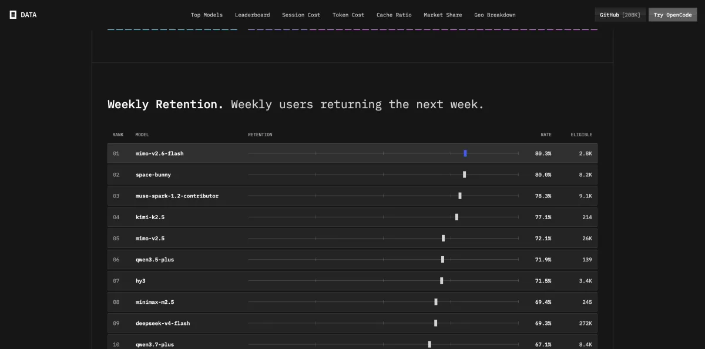
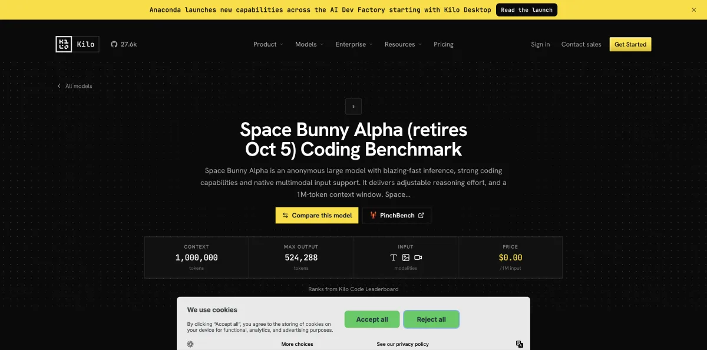
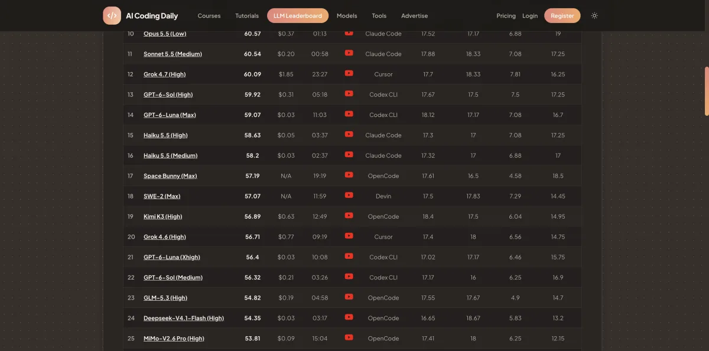

> **先说结论。** 太空兔（Space Bunny Alpha）现在还能免费用，但只剩 **OpenCode Zen** 一处。在 OpenCode 应用或命令行里选 `opencode/space-bunny-free` 就行，不用注册账号。免费额度按 IP 每天计算，Zen 没说什么时候停。[^zen-docs]
>
> 另外四个渠道在 10 月 5 日、6 日陆续停了。

{{live:where-to-use model=space-bunny}}

[太空兔](https://freetokens.fyi/zh/models/space-bunny)是 9 月 23 日突然冒出来的：不署名，1M 上下文，五个渠道同时免费。之后两周，它一直是免费圈里用量最大的模型之一。然后渠道一家家关掉，背后的公司到现在也没露面。

这篇上半部分给结论，下半部分是[详细资料](#deep-dive)：每个渠道怎么停的、逐日时间线、所有外部测评、各平台的讨论。只想知道能不能用、好不好用，看上半部分就够了。

## 哪些渠道免费过，什么时候停的 {#where-free}

| 渠道 | 免费开始 | 免费截止 | 怎么确认停了 |
|---|---|---|---|
| [OpenRouter](https://freetokens.fyi/zh/channels/openrouter) | 9 月 23 日 | 10 月 5 日 | 官方发帖说隐身期结束。[^openrouter-oct5-end] |
| [Command Code](https://freetokens.fyi/zh/channels/command-code) | 9 月 24 日 | 10 月 5 日 | 提前公告“till Oct 5”，当晚起调用返回 404。[^command-oct1] |
| [Kilo Code](https://freetokens.fyi/zh/channels/kilo-code) | 9 月 23 日 | 10 月 5 日 | 模型页写着“retires Oct 5”。[^kilo-oct5] |
| [OpenCode Go](https://freetokens.fyi/zh/channels/opencode-go) | 9 月 23 日 | 10 月 6 日 | 改成了付费版。[^go-pr-end] |
| **[OpenCode Zen](https://freetokens.fyi/zh/channels/opencode-zen)** | 9 月 23 日 | **仍免费** | 标“限时免费”，没给日期。[^zen-docs] |

如果你是从搜索点进 Kilo 的网页，注意：那个页面到现在还显示免费，其实一周前命令行里就没有这个模型了，以命令行为准。

国内还有一个入口要分清：腾讯 WorkBuddy 10 月 2 日宣布独家接入，打的是限时折扣，**要花钱**，不算免费渠道。[^ithome-workbuddy]

## 现在怎么在 Zen 上用 {#use-it}

打开 OpenCode 应用或命令行，模型选 `opencode/space-bunny-free`，不用注册，也不用绑卡。真要拿它干活，先知道三件事：

- **额度按 IP 每天算。** Zen 没公布具体数字。公司网络、VPN 这种很多人共用一个出口 IP 的情况，大概率是大家分同一份额度。
- **Zen 承诺不留存数据、不拿你的提示词训练。**[^zen-docs] 这只管 Zen 自己怎么处理，背后跑模型的是谁，仍然不知道。
- **随时可能停。** 别的渠道都已经关了。如果有东西依赖它，准备好备选。

## 它有多强 {#how-good}

Artificial Analysis 还没给它打分，没公开身份的模型一般都这样。我们估它在 AA 指数上大约 **43 到 48**，放在编程模型里是中游，不算顶尖。这个数只能粗看，因为只靠一份公开榜单：AI Coding Daily，它在 42 个模型里排第 17。[^aicodingdaily] 怎么换算写在[方法页](https://freetokens.fyi/zh/methodology)。

其他人做过的测试都用的小题集，不影响我们的估分，但结论和估分是一致的。每一项都列在[下面](#tests)。

用的人多不多，比分数更说明问题。它在 OpenRouter 上最高冲到周榜第 3。[^or-rankings] 在 OpenCode 上，token 用量排第 3，周留存 80%，全平台第 2。[^oc-data]

## 它是怎么冒出来的 {#origin}

事先没有任何泄露。9 月 23 日 14:31（UTC），OpenCode 发帖说它“下周免费”，1M 上下文，支持多模态。[^opencode-sep23] 十八分钟后 OpenRouter 也发了，说它是“推理快、推理强度可调的 flash 模型”。[^openrouter-sep23] 两条帖子互不引用，更像两个渠道按同一个时间表上线，而不是一家转述另一家。上线也不顺：半小时后 OpenRouter 说提供方那边出了问题，先下线，三小时内又恢复了。[^openrouter-outage][^openrouter-back]

## 到底是谁做的 {#maker}

没人认领。OpenRouter 10 月 5 日说背后的模型“很快会公布”，[^openrouter-oct5-end] 过了八天，模型页上写的还是匿名提供方，OpenRouter 只负责转发。[^openrouter-page]

大部分证据指向 [MiniMax](https://freetokens.fyi/zh/makers/minimax)，而且几乎都来自同一种方法：tokenizer 指纹（[下面](#fingerprinting)有解释）。好几拨人各自测了，结论一致。但 MiniMax 更早的一个模型也能对上，所以证据最多只能说明是这个家族，指不到具体哪个版本。[^cellcog-maker]

| 说法 | 靠谱程度 |
|---|---|
| 制造方没公开，OpenRouter 只负责转发 | 确定，OpenRouter 自己的页面就这么写 |
| 出自 MiniMax 家族 | 很可能。几组独立的 tokenizer 测试结论一致，但没有官方确认 |
| 就是 MiniMax M3.1 | 有可能。参数和时间都对得上，但更早的 MiniMax 模型也能对上指纹 |
| 是谷歌、Gemini 或 Mistral 的模型 | 没有依据。论坛猜测，没有测试支撑 |
| “85% 是 MiniMax”“4860 亿参数” | 单一来源，核实不了，我们不当事实写 |

知道是哪一片小区，还不知道是哪一户。

## 接下来盯什么 {#watching}

- **Zen 什么时候停。** OpenCode 没说。页首“现在哪里免费”卡片每次构建都会按最新数据更新。
- **谁出来认领。** 只有 OpenRouter 或制造方正式公布，“谁做的”那一节才会改。
- **其他四家会不会重新上。** 目前都没消息，Go 已经改成付费版在卖。
- **正式跑分。** 一旦公布身份，Artificial Analysis 大概率会给它打分，到时候我们的估算就换成真实分数。

---

## 详细资料 {#deep-dive}

下面是上半部分结论背后的细节，留给想自己核对、或者想顺着某条线索往下挖的人。

### 每个渠道是怎么停的 {#channels}

**[OpenRouter](https://freetokens.fyi/zh/channels/openrouter)** 从第一天起就以 `stealth/space-bunny-alpha` 上架。[^openrouter-sep23] 隐身期本来不长，9 月 30 日延长到 10 月 5 日，[^openrouter-sep30] 当天 16:02（UTC）发帖宣布结束。[^openrouter-oct5-end] 模型页现在挂着“免费期已结束”的横幅。[^or-model]

**[Command Code](https://freetokens.fyi/zh/channels/command-code)** 晚一天加入，9 月 24 日宣布所有套餐可用。[^command-blog] 10 月 1 日给出截止日：“till Oct 5 on all plans”，[^command-oct1] 说到做到。10 月 5 日 19:02（UTC）起，我们的调用都返回 404，第二天的更新日志里写着下线“两个免费隐身预览模型”。[^command-changelog] 五家里，它的记录最完整。

**[Kilo Code](https://freetokens.fyi/zh/channels/kilo-code)** 9 月 23 日上架。10 月初页面标题改成“Space Bunny Alpha (retires Oct 5)”，[^kilo-oct5] 10 月 6 日命令行的模型列表里就没有了。网页却一直没跟上，10 月 12 日还写着“Available at no cost”。

**[OpenCode Go](https://freetokens.fyi/zh/channels/opencode-go)** 本来是 OpenCode 的付费订阅，这两周顺带挂了一个免费推广版，上线当天加的，代码里标着限时。[^go-pr-start] 它比 Command Code 多撑了一会儿：10 月 5 日 19:06（UTC）还能正常回答。10 月 6 日调用开始报服务器错误，同一天合入了一条“list paid Space Bunny”的改动。[^go-pr-end] 模型没离开 Go，只是不再免费。[^go-page]

**[OpenCode Zen](https://freetokens.fyi/zh/channels/opencode-zen)** 上线当天就写进了文档，[^zen-commit] 模型列表里至今还有 `space-bunny-free`。[^zen-models] 10 月 6 日，我们不登录账号、从两个不同网络同时发十个请求，它都正常回答了。

### 逐日时间线 {#timeline}

时间均为 UTC。

- **9 月 23 日 14:31**　OpenCode 宣布“下周免费”。[^opencode-sep23]
- **9 月 23 日 14:49**　OpenRouter 上架，支持文字、图片、视频输入。[^openrouter-sep23] Kilo 和 OpenCode Go 当天也上架。
- **9 月 23 日 15:18**　OpenRouter 因提供方问题下线，[^openrouter-outage] 17:29 恢复。[^openrouter-back]
- **9 月 24 日**　Command Code 全套餐上线。[^command-sep24] 关于 MiniMax 的猜测开始在 X 和 linux.do 上流传。[^mark-k][^linuxdo-24]
- **9 月 28 日**　据一篇引用后台数据的文章，它登上 OpenRouter 日榜第一。[^cellcog-maker] 前后同一时间，MiniMax 发布 M3.1-Flash-Preview，只字未提太空兔。[^shobserver]
- **9 月 29 日**　Hacker News 上有人开帖问：背后到底是谁。[^hn-ask]
- **9 月 30 日**　OpenRouter 把免费期延长到 10 月 5 日。[^openrouter-sep30]
- **10 月 1 日**　Command Code 定下同一个截止日。[^command-oct1]
- **10 月 5 日**　16:02 OpenRouter 结束隐身期，[^openrouter-oct5-end] 19:02 Command Code 停止响应，Kilo 页面写当天下线。[^kilo-oct5]
- **10 月 6 日**　Go 改为付费版，[^go-pr-end] Kilo 命令行里也没了。Zen 照常回答。
- **10 月 13 日**　制造方仍未公布，[^openrouter-page] Zen 仍然免费。

9 月 23 日 14:31 之前，我们没找到任何痕迹。雪球上有一篇投资帖说它 22 日就上线了，但别的来源都对不上这个日期。[^xueqiu-maker]

### 所有外部测评 {#tests}

- **AI Coding Daily**（我们唯一计入估分的一项）：42 个模型里排第 17，70 分拿了 57.19。[^aicodingdaily]
- **Fellipe Soares** 10 月 4 日把几个隐身模型放在一起测。[^fellipe] 太空兔在他的综合指数上拿 53 分，和 [Fledge Alpha](https://freetokens.fyi/zh/models/fledge-alpha) 持平，落后 [Big Pickle](https://freetokens.fyi/zh/models/big-pickle) 的 57。14 题的 Terminal-Bench 子集做对 64%，20 题的 SWE-bench 样本做对 75%，基于 jinja 项目的 15 个任务全部完成。他自己也说，题量这么小，分不出接近的模型。
- **StealthMark** 专门评隐身模型，部分题目是画 SVG，太空兔在 43 个里排第 12，49.4 分。[^stealthmark] 它视觉题明显比通用推理题好，和“多模态模型”的定位对得上。
- **Kilo 自己的排行榜** 把它排在旧版 Orchestrator 模式第 39。[^kilo-oct5] 这只是 Kilo 内部比较。
- **spacebunnyalpha.com** 是粉丝自建的页面，自测分数高得多，比如 GPQA Diamond 60 题子集 82%。[^sbalpha-self] 自己测、用子集，我们不采信。
- **一个张冠李戴的数字。** 网上流传的“GPQA 56.4%”其实是另一个隐身模型 [Glyph Cluster](https://freetokens.fyi/zh/models/glyph-cluster) 的成绩。[^glyph-note]

OpenCode 上的日用量在 10 月 5 日见顶，正好是三个渠道同时关掉的那天，之后一周跌掉三分之二以上，只剩 Zen 一家在撑。[^oc-data]

### 各平台怎么说 {#reactions}

- **X。** Mark Kretschmann 9 月 24 日发帖说，社区指纹指向 MiniMax M3.1 预览版，但没人官方确认。[^mark-k] TestingCatalog 把这个说法带到了 Threads。[^testingcatalog] Vaibhav Sisinty 不管是谁做的，只说它“写代码是真的好”。[^sisinty]
- **Reddit。** 技术分析最多。一篇题为“M3.1 is SpaceBunny”的帖子用七个测试字符串，token 数都和 MiniMax 的模型对上；另一篇说又对上了六个，比较对象有 GLM、DeepSeek 等。[^reddit-m31] 这些帖子我们只能看到搜索摘要，所以只当线索，不当证据。
- **Hacker News。** 一直在猜，没人知道。上线当天有条回复转述“Reddit 上的人觉得是 MiniMax”，[^hn-reddit] 9 月 29 日有人直接开帖问是谁，[^hn-ask] 后面的评论要么重复 tokenizer 的传言，[^hn-lucrbvi] 要么说有“MiniMax 变体的迹象”。[^hn-minimax-variant]
- **中文论坛。** linux.do 上线当天就有人猜 MiniMax，最早是看它画的图像风格；[^linuxdo-23] 同一天的回复里提到 token 测试命中 MiniMax，[^linuxdo-pelican] 第二天有帖子说“基本确认”。[^linuxdo-24] 这几个页面我们只看得到标题和摘要，“基本确认”不当结论用。V2EX 反而只有一个帖子，零回复。[^v2ex]
- **中文媒体。** 观察者网报道有独立研究者做了 24 次 token 探测，同时提醒：不同模型可以共用一套 tokenizer，对上了只说明有亲缘，说明不了是同一个。[^guancha] 其他媒体转述了一个 50 个字符串的测试，原始页面我们没找到。[^tmtpost]
- **一个说过头的标题。** StartupFortune 的标题说 MiniMax 悄悄把新模型塞进了自家工具，正文却承认什么都没确认。[^minimax-report]
- **MiniMax 自己。** M3.1-Flash-Preview 发布后，有中文开发者惊讶地问：原来它不是太空兔吗。[^coder-left] MiniMax 一直没认领。

### tokenizer 指纹是怎么回事 {#fingerprinting}

模型读文字之前，会先把文字切成一个个小块，叫 token。每个模型家族切法不同。拿一些怪符号、生僻词喂给模型，看它报告用了多少 token，就能得到一组特征。再拿已知厂商的模型做同样的测试，就能看出这个神秘模型跟谁对得上。

这个方法有两个局限。一是不同模型可以共用同一套 tokenizer，对上了只说明有关系，说明不了是谁。[^guancha] 二是有一份比较细的分析把旧模型也测了，发现 MiniMax 的 [M2.7](https://freetokens.fyi/zh/models/minimax-m2.7) 也能对上，所以证据只能停在家族这一层。[^cellcog-maker] 另外还有几条线索也指向这个家族：据报道 MiniMax 自家的编程工具在发布前就出现过 M3.1 的字样，[^blockbeats] 公开的参数也对得上。但这些都不算确认。

### 其他猜测和流传的数字 {#other-clues}

也不是人人都猜 MiniMax。Reddit 和 4chan 上有人猜 Gemini 4，有人猜 Mistral 的项目，也有人泛泛地说是谷歌。[^reddit-m31] 这些猜测互相矛盾，也没有测试支撑，最多说明大家从来没完全统一过意见。

有几个数字总跟着这个故事一起出现，看到时心里有数就行：

- **“85% 是 MiniMax”。** 出自雪球上的一篇个人投资帖，帖子里还提到 4860 亿参数，作者自己也说没法确认。[^xueqiu-maker] 它引用的主要来源我们没找到。
- **“50 个字符串全部对上”。** 好几家中文媒体转述，都指向一个叫 YFarmX 的网站，原始页面我们没找到。[^tmtpost][^nbd]
- **参数和 MiniMax 的路线吻合。** 1M 上下文、多模态、推理强度可调，确实像 MiniMax 在做的东西。但长这样的模型不止一个，参数对上只能说明它是候选，不能说明就是它。

利益声明：freetokens 和本文提到的任何渠道、公司都没有商业关系。
